# systemmodel

## Imports

### External imports

| Name | Path                   | Count |
|:-----|:-----------------------|------:|
| uuid | github.com/google/uuid |     1 |

### Std imports

| Name    | Path    | Count |
|:--------|:--------|------:|
| context | context |     1 |
| time    | time    |     1 |

## Used by

| Name                | Path                                                                                           |
|:--------------------|:-----------------------------------------------------------------------------------------------|
| server              | [/internal/application/server](../application/server.md)                                       |
| systemhandlers      | [/internal/controllers/serverapi/systemhandlers](../controllers/serverapi/systemhandlers.md)   |
| workermanager       | [/internal/controllers/workermanager](../controllers/workermanager.md)                         |
| metric              | [/internal/dataproviders/metric](../dataproviders/metric.md)                                   |
| metricserver        | [/internal/dataproviders/metric/metricserver](../dataproviders/metric/metricserver.md)         |
| other               | [/internal/dataproviders/serverdb/internal/other](../dataproviders/serverdb/internal/other.md) |
| tmpdata             | [/internal/dataproviders/tmpdata](../dataproviders/tmpdata.md)                                 |
| attributeusecase    | [/internal/usecases/attributeusecase](../usecases/attributeusecase.md)                         |
| cleanupusecase      | [/internal/usecases/cleanupusecase](../usecases/cleanupusecase.md)                             |
| deduplicatorusecase | [/internal/usecases/deduplicatorusecase](../usecases/deduplicatorusecase.md)                   |
| labelusecase        | [/internal/usecases/labelusecase](../usecases/labelusecase.md)                                 |
| massloadusecase     | [/internal/usecases/massloadusecase](../usecases/massloadusecase.md)                           |
| systemusecase       | [/internal/usecases/systemusecase](../usecases/systemusecase.md)                               |

## Scheme

```mermaid
erDiagram
    "/internal/application/server" ||--|{ "/internal/domain/systemmodel" : x1
    "/internal/controllers/serverapi/systemhandlers" ||--|{ "/internal/domain/systemmodel" : x4
    "/internal/controllers/workermanager" ||--|{ "/internal/domain/systemmodel" : x2
    "/internal/dataproviders/metric" ||--|{ "/internal/domain/systemmodel" : x1
    "/internal/dataproviders/metric/metricserver" ||--|{ "/internal/domain/systemmodel" : x1
    "/internal/dataproviders/serverdb/internal/other" ||--|{ "/internal/domain/systemmodel" : x1
    "/internal/dataproviders/tmpdata" ||--|{ "/internal/domain/systemmodel" : x2
    "/internal/usecases/attributeusecase" ||--|{ "/internal/domain/systemmodel" : x1
    "/internal/usecases/cleanupusecase" ||--|{ "/internal/domain/systemmodel" : x7
    "/internal/usecases/deduplicatorusecase" ||--|{ "/internal/domain/systemmodel" : x1
    "/internal/usecases/labelusecase" ||--|{ "/internal/domain/systemmodel" : x1
    "/internal/usecases/massloadusecase" ||--|{ "/internal/domain/systemmodel" : x2
    "/internal/usecases/systemusecase" ||--|{ "/internal/domain/systemmodel" : x3
```

---

> Generated by [goArchLint](https://github.com/gbh007/goarchlint)
