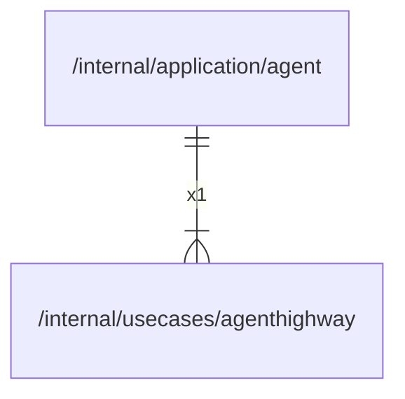

# agenthighway

## Imports

### External imports

| Name | Path                   | Count |
|:-----|:-----------------------|------:|
| uuid | github.com/google/uuid |     1 |

### Std imports

| Name    | Path    | Count |
|:--------|:--------|------:|
| context | context |     1 |
| errors  | errors  |     1 |
| io      | io      |     1 |
| time    | time    |     1 |

## Used by

| Name  | Path                                                   |
|:------|:-------------------------------------------------------|
| agent | [/internal/application/agent](../application/agent.md) |

## Scheme

---

> Generated by [goArchLint](https://github.com/gbh007/goarchlint)
