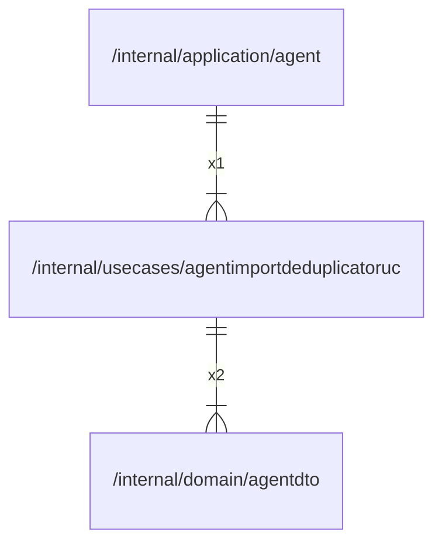

# agentimportdeduplicatoruc

## Imports

### Inner imports

| Name     | Path                                               | Count |
|:---------|:---------------------------------------------------|------:|
| agentdto | [/internal/domain/agentdto](../domain/agentdto.md) |     2 |

### Std imports

| Name    | Path     | Count |
|:--------|:---------|------:|
| context | context  |     2 |
| slog    | log/slog |     2 |
| fmt     | fmt      |     1 |
| io      | io       |     1 |
| time    | time     |     1 |

## Used by

| Name  | Path                                                   |
|:------|:-------------------------------------------------------|
| agent | [/internal/application/agent](../application/agent.md) |

## Scheme

---

> Generated by [goArchLint](https://github.com/gbh007/goarchlint)
