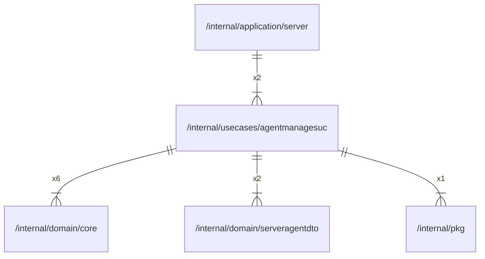

# agentmanagesuc

## Imports

### Inner imports

| Name           | Path                                                           | Count |
|:---------------|:---------------------------------------------------------------|------:|
| core           | [/internal/domain/core](../domain/core.md)                     |     6 |
| serveragentdto | [/internal/domain/serveragentdto](../domain/serveragentdto.md) |     2 |
| pkg            | [/internal/pkg](../pkg.md)                                     |     1 |

### External imports

| Name | Path                   | Count |
|:-----|:-----------------------|------:|
| uuid | github.com/google/uuid |     4 |

### Std imports

| Name    | Path     | Count |
|:--------|:---------|------:|
| context | context  |     6 |
| fmt     | fmt      |     5 |
| errors  | errors   |     2 |
| slog    | log/slog |     1 |
| time    | time     |     1 |

## Used by

| Name   | Path                                                     |
|:-------|:---------------------------------------------------------|
| server | [/internal/application/server](../application/server.md) |

## Scheme

---

> Generated by [goArchLint](https://github.com/gbh007/goarchlint)
