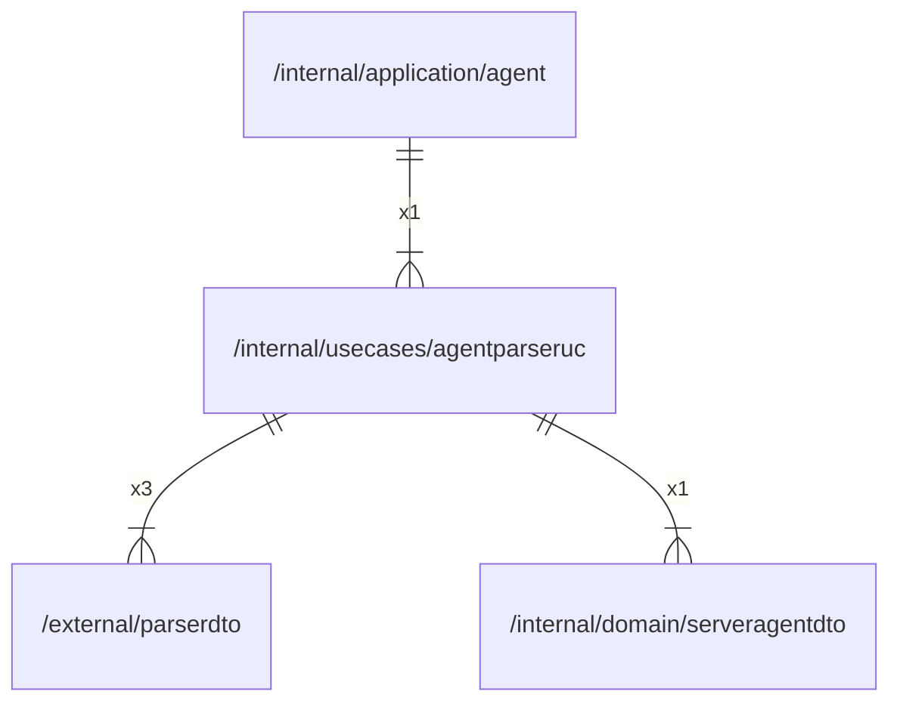

# agentparseruc

## Imports

### Inner imports

| Name           | Path                                                           | Count |
|:---------------|:---------------------------------------------------------------|------:|
| parserdto      | [/external/parserdto](../../external/parserdto.md)             |     3 |
| serveragentdto | [/internal/domain/serveragentdto](../domain/serveragentdto.md) |     1 |

### External imports

| Name | Path                 | Count |
|:-----|:---------------------|------:|
| lo   | github.com/samber/lo |     1 |

### Std imports

| Name    | Path     | Count |
|:--------|:---------|------:|
| context | context  |     5 |
| url     | net/url  |     5 |
| fmt     | fmt      |     2 |
| io      | io       |     2 |
| slog    | log/slog |     1 |

## Used by

| Name  | Path                                                   |
|:------|:-------------------------------------------------------|
| agent | [/internal/application/agent](../application/agent.md) |

## Scheme

---

> Generated by [goArchLint](https://github.com/gbh007/goarchlint)
