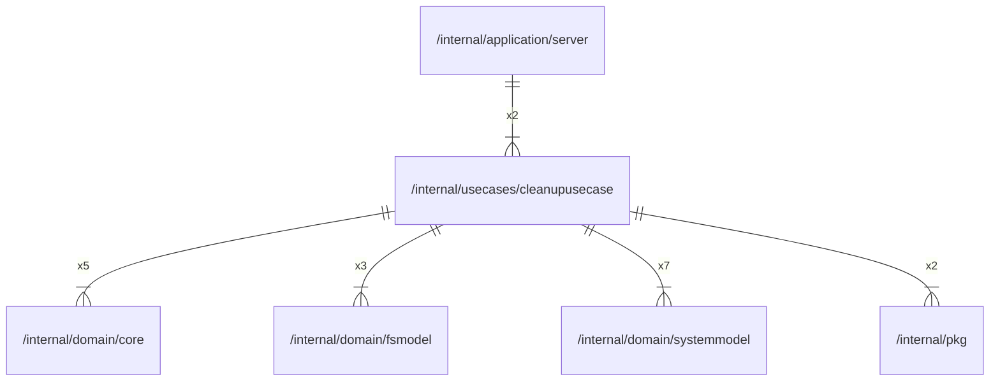

# cleanupusecase

## Imports

### Inner imports

| Name        | Path                                                     | Count |
|:------------|:---------------------------------------------------------|------:|
| systemmodel | [/internal/domain/systemmodel](../domain/systemmodel.md) |     7 |
| core        | [/internal/domain/core](../domain/core.md)               |     5 |
| fsmodel     | [/internal/domain/fsmodel](../domain/fsmodel.md)         |     3 |
| pkg         | [/internal/pkg](../pkg.md)                               |     2 |

### External imports

| Name | Path                   | Count |
|:-----|:-----------------------|------:|
| uuid | github.com/google/uuid |     4 |

### Std imports

| Name    | Path     | Count |
|:--------|:---------|------:|
| context | context  |     8 |
| fmt     | fmt      |     6 |
| slog    | log/slog |     4 |
| bytes   | bytes    |     1 |
| slices  | slices   |     1 |
| time    | time     |     1 |

## Used by

| Name   | Path                                                     |
|:-------|:---------------------------------------------------------|
| server | [/internal/application/server](../application/server.md) |

## Scheme

---

> Generated by [goArchLint](https://github.com/gbh007/goarchlint)
