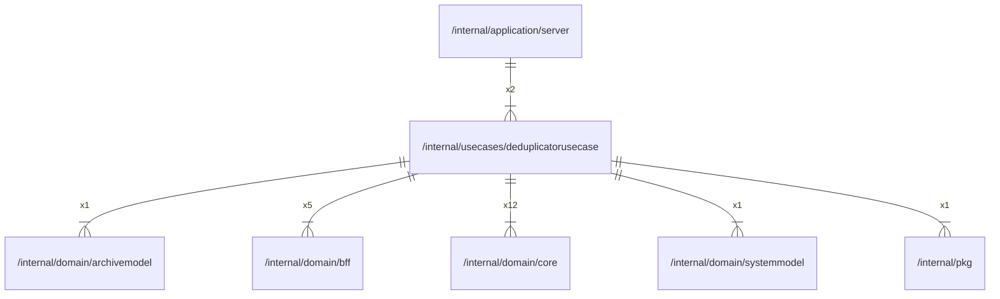

# deduplicatorusecase

## Imports

### Inner imports

| Name         | Path                                                       | Count |
|:-------------|:-----------------------------------------------------------|------:|
| core         | [/internal/domain/core](../domain/core.md)                 |    12 |
| bff          | [/internal/domain/bff](../domain/bff.md)                   |     5 |
| archivemodel | [/internal/domain/archivemodel](../domain/archivemodel.md) |     1 |
| systemmodel  | [/internal/domain/systemmodel](../domain/systemmodel.md)   |     1 |
| pkg          | [/internal/pkg](../pkg.md)                                 |     1 |

### External imports

| Name | Path                   | Count |
|:-----|:-----------------------|------:|
| uuid | github.com/google/uuid |    10 |

### Std imports

| Name    | Path        | Count |
|:--------|:------------|------:|
| context | context     |    12 |
| fmt     | fmt         |    11 |
| slices  | slices      |     5 |
| time    | time        |     4 |
| zip     | archive/zip |     1 |
| bytes   | bytes       |     1 |
| errors  | errors      |     1 |
| io      | io          |     1 |
| slog    | log/slog    |     1 |
| path    | path        |     1 |

## Used by

| Name   | Path                                                     |
|:-------|:---------------------------------------------------------|
| server | [/internal/application/server](../application/server.md) |

## Scheme

---

> Generated by [goArchLint](https://github.com/gbh007/goarchlint)
