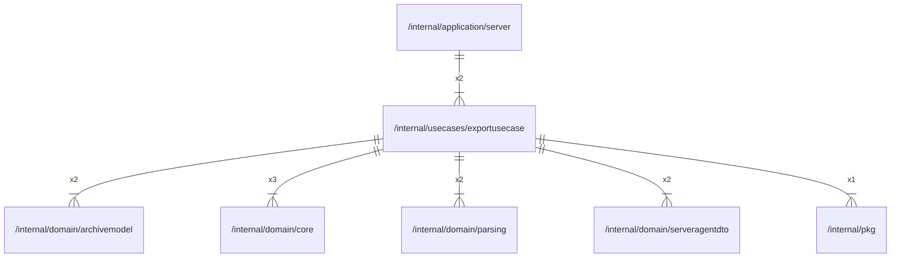

# exportusecase

## Imports

### Inner imports

| Name           | Path                                                           | Count |
|:---------------|:---------------------------------------------------------------|------:|
| core           | [/internal/domain/core](../domain/core.md)                     |     3 |
| archivemodel   | [/internal/domain/archivemodel](../domain/archivemodel.md)     |     2 |
| parsing        | [/internal/domain/parsing](../domain/parsing.md)               |     2 |
| serveragentdto | [/internal/domain/serveragentdto](../domain/serveragentdto.md) |     2 |
| pkg            | [/internal/pkg](../pkg.md)                                     |     1 |

### External imports

| Name | Path                   | Count |
|:-----|:-----------------------|------:|
| uuid | github.com/google/uuid |     3 |

### Std imports

| Name    | Path        | Count |
|:--------|:------------|------:|
| context | context     |     3 |
| io      | io          |     3 |
| zip     | archive/zip |     2 |
| bytes   | bytes       |     2 |
| fmt     | fmt         |     2 |
| slog    | log/slog    |     2 |
| errors  | errors      |     1 |
| url     | net/url     |     1 |
| time    | time        |     1 |

## Used by

| Name   | Path                                                     |
|:-------|:---------------------------------------------------------|
| server | [/internal/application/server](../application/server.md) |

## Scheme

---

> Generated by [goArchLint](https://github.com/gbh007/goarchlint)
