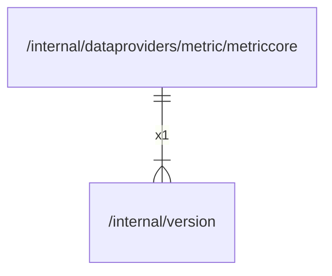

# version

## Imports

### Std imports

| Name    | Path          | Count |
|:--------|:--------------|------:|
| runtime | runtime       |     1 |
| debug   | runtime/debug |     1 |

## Used by

| Name       | Path                                                                            |
|:-----------|:--------------------------------------------------------------------------------|
| metriccore | [/internal/dataproviders/metric/metriccore](dataproviders/metric/metriccore.md) |

## Scheme

---

> Generated by [goArchLint](https://github.com/gbh007/goarchlint)
