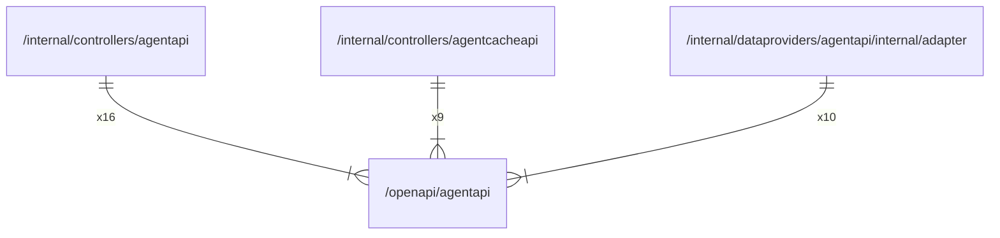

# agentapi

## Imports

### External imports

| Name       | Path                               | Count |
|:-----------|:-----------------------------------|------:|
| errors     | github.com/go-faster/errors        |    10 |
| ogenerrors | github.com/ogen-go/ogen/ogenerrors |     7 |
| http       | github.com/ogen-go/ogen/http       |     6 |
| jx         | github.com/go-faster/jx            |     5 |
| uri        | github.com/ogen-go/ogen/uri        |     5 |
| validate   | github.com/ogen-go/ogen/validate   |     5 |
| conv       | github.com/ogen-go/ogen/conv       |     4 |
| middleware | github.com/ogen-go/ogen/middleware |     4 |
| uuid       | github.com/google/uuid             |     3 |
| json       | github.com/ogen-go/ogen/json       |     1 |

### Std imports

| Name    | Path      | Count |
|:--------|:----------|------:|
| http    | net/http  |     9 |
| url     | net/url   |     5 |
| context | context   |     4 |
| io      | io        |     4 |
| strings | strings   |     4 |
| bytes   | bytes     |     3 |
| fmt     | fmt       |     2 |
| mime    | mime      |     2 |
| bits    | math/bits |     1 |
| strconv | strconv   |     1 |
| time    | time      |     1 |

## Used by

| Name          | Path                                                                                                        |
|:--------------|:------------------------------------------------------------------------------------------------------------|
| agentapi      | [/internal/controllers/agentapi](../internal/controllers/agentapi.md)                                       |
| agentcacheapi | [/internal/controllers/agentcacheapi](../internal/controllers/agentcacheapi.md)                             |
| adapter       | [/internal/dataproviders/agentapi/internal/adapter](../internal/dataproviders/agentapi/internal/adapter.md) |

## Scheme

---

> Generated by [goArchLint](https://github.com/gbh007/goarchlint)
