# serverapi

## Imports

### External imports

| Name       | Path                               | Count |
|:-----------|:-----------------------------------|------:|
| errors     | github.com/go-faster/errors        |    10 |
| ogenerrors | github.com/ogen-go/ogen/ogenerrors |     7 |
| http       | github.com/ogen-go/ogen/http       |     6 |
| jx         | github.com/go-faster/jx            |     5 |
| uri        | github.com/ogen-go/ogen/uri        |     5 |
| validate   | github.com/ogen-go/ogen/validate   |     5 |
| conv       | github.com/ogen-go/ogen/conv       |     4 |
| middleware | github.com/ogen-go/ogen/middleware |     4 |
| uuid       | github.com/google/uuid             |     3 |
| json       | github.com/ogen-go/ogen/json       |     1 |

### Std imports

| Name    | Path      | Count |
|:--------|:----------|------:|
| http    | net/http  |     9 |
| url     | net/url   |     5 |
| context | context   |     4 |
| io      | io        |     4 |
| strings | strings   |     4 |
| bytes   | bytes     |     3 |
| fmt     | fmt       |     3 |
| mime    | mime      |     2 |
| time    | time      |     2 |
| bits    | math/bits |     1 |
| strconv | strconv   |     1 |

## Used by

| Name                | Path                                                                                                            |
|:--------------------|:----------------------------------------------------------------------------------------------------------------|
| serverapi           | [/internal/controllers/serverapi](../internal/controllers/serverapi.md)                                         |
| agenthandlers       | [/internal/controllers/serverapi/agenthandlers](../internal/controllers/serverapi/agenthandlers.md)             |
| apiservercore       | [/internal/controllers/serverapi/apiservercore](../internal/controllers/serverapi/apiservercore.md)             |
| attributehandlers   | [/internal/controllers/serverapi/attributehandlers](../internal/controllers/serverapi/attributehandlers.md)     |
| bookhandlers        | [/internal/controllers/serverapi/bookhandlers](../internal/controllers/serverapi/bookhandlers.md)               |
| deduplicatehandlers | [/internal/controllers/serverapi/deduplicatehandlers](../internal/controllers/serverapi/deduplicatehandlers.md) |
| fshandlers          | [/internal/controllers/serverapi/fshandlers](../internal/controllers/serverapi/fshandlers.md)                   |
| hproxyhandlers      | [/internal/controllers/serverapi/hproxyhandlers](../internal/controllers/serverapi/hproxyhandlers.md)           |
| labelhandlers       | [/internal/controllers/serverapi/labelhandlers](../internal/controllers/serverapi/labelhandlers.md)             |
| massloadhandlers    | [/internal/controllers/serverapi/massloadhandlers](../internal/controllers/serverapi/massloadhandlers.md)       |
| systemhandlers      | [/internal/controllers/serverapi/systemhandlers](../internal/controllers/serverapi/systemhandlers.md)           |
| masterapi           | [/internal/dataproviders/masterapi](../internal/dataproviders/masterapi.md)                                     |

## Scheme

```mermaid
erDiagram
    "/internal/controllers/serverapi" ||--|{ "/openapi/serverapi" : x4
    "/internal/controllers/serverapi/agenthandlers" ||--|{ "/openapi/serverapi" : x6
    "/internal/controllers/serverapi/apiservercore" ||--|{ "/openapi/serverapi" : x3
    "/internal/controllers/serverapi/attributehandlers" ||--|{ "/openapi/serverapi" : x12
    "/internal/controllers/serverapi/bookhandlers" ||--|{ "/openapi/serverapi" : x10
    "/internal/controllers/serverapi/deduplicatehandlers" ||--|{ "/openapi/serverapi" : x6
    "/internal/controllers/serverapi/fshandlers" ||--|{ "/openapi/serverapi" : x11
    "/internal/controllers/serverapi/hproxyhandlers" ||--|{ "/openapi/serverapi" : x4
    "/internal/controllers/serverapi/labelhandlers" ||--|{ "/openapi/serverapi" : x8
    "/internal/controllers/serverapi/massloadhandlers" ||--|{ "/openapi/serverapi" : x16
    "/internal/controllers/serverapi/systemhandlers" ||--|{ "/openapi/serverapi" : x12
    "/internal/dataproviders/masterapi" ||--|{ "/openapi/serverapi" : x3
```

---

> Generated by [goArchLint](https://github.com/gbh007/goarchlint)
